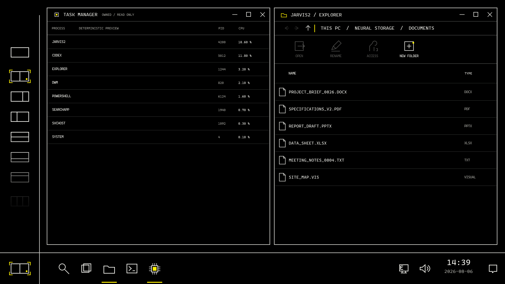
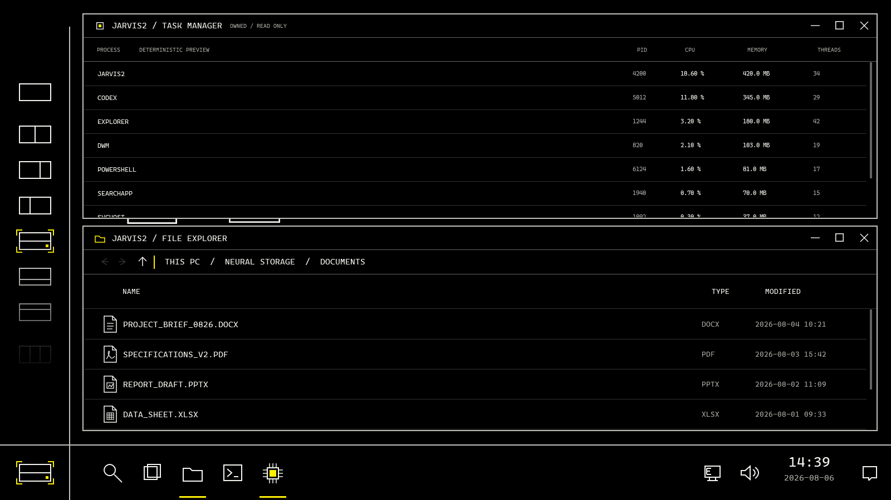

# Windows 10 owned-window layouts

The Horizon Membrane preview now applies layout presets to its registered
Explorer and read-only Task Manager surfaces. The initial desktop is Freeform:
each surface retains its own floating bounds, and the current-layout slot shows
overlapping windows instead of claiming that a tiled preset is applied.

## Availability and placement

The catalog contains sixteen exact-cover topologies. A preset is available
only when enough registered windows are visible. The initial Explorer enables
the single-window maximized preset; opening Task Manager enables that preset
and all six two-window splits. Three- and four-window layouts remain disabled
with an explanation of the required visible-window count. Selecting an
unavailable layout changes neither bounds nor the applied preset. It never
creates a window or restores a minimized window to fill a pane.

The active window occupies the largest pane. Equal-area panes use top-to-bottom,
left-to-right order; remaining participants follow activation order and then
registration order. Extra visible windows retain their bounds. The usable area
is `(148, 24, 1428, 752)` DIP, internal gaps are 12 DIP, and placement edges are
rounded to integer device-independent coordinates.

## Lifecycle and compact presentation

Minimizing retains the assigned pane; restoring returns to it. Closing breaks
the applied layout, and reopening returns to the last independent floating
bounds. Dragging either owned title bar returns the desktop to Freeform.
Maximize applies the single-window preset; restore reapplies the last usable
tiled preset, or restores floating bounds when it is no longer available.
Body clicks and keyboard focus update the active window and stacking order.

Below 820 DIP width, Explorer uses a compact file ledger and Task Manager uses
process name, PID and CPU columns. Below 400 DIP height, auxiliary summaries
collapse. Explorer also collapses its folder illustration and storage rows in
compact presentation. Hidden panels are explicitly collapsed, so fixed-size
children cannot spill into title bars or remain keyboard targets. Task Manager
retains its sampling status in the compact ledger header. Full row values and
file names remain available to accessibility and tooltips.





These images use deterministic preview processes and virtual files. They do not
show a live Windows Task Manager or a styled Windows Explorer.

## Verification

`test-owned-window-layout` runs 16 coordinator scenarios and 8 hosted WPF
scenarios. Hosted checks cover both active-window choices for all six splits,
actual element bounds, disabled no-op behavior, compact controls, lifecycle,
focus and manual movement. Explorer retains at least 44 DIP of content viewport
and Task Manager at least 43 DIP in every available split.

The row/column render checks also require actual Task Manager title-rule and
window-control pixels. Deterministic scenes are admitted before the first native
frame, preventing a shorter tile from retaining its earlier floating clip.

The public gate includes these scenarios:

```powershell
pwsh -File .\scripts\Test-Windows10NeuralVoidPreview.ps1
```

Reproduce a deterministic layout frame:

```powershell
dotnet .\src\platforms\windows10\Jarvis.Win10.NeuralVoidPreview\bin\Release\net8.0-windows\jarvis-win10-neural-void-preview.dll `
  render-owned-layout .\owned-layout.png 56.470588 static 0 EqualColumns
```

The receipt remains `ownProcessOnly=true`,
`thirdPartyWindowControlSupported=false`, `shellMutationSupported=false`,
`liveExplorer=not-run`, and `mutationPerformed=false`. This slice registers no
third-party HWND and introduces no Shell transport or injection authority.
